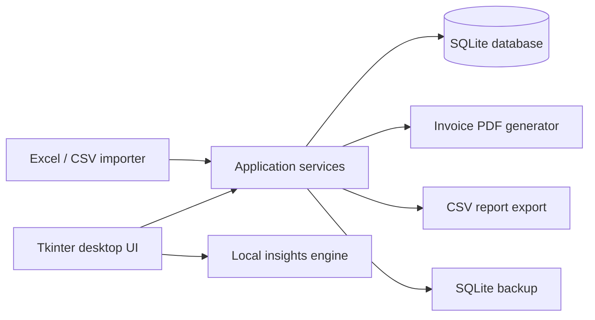
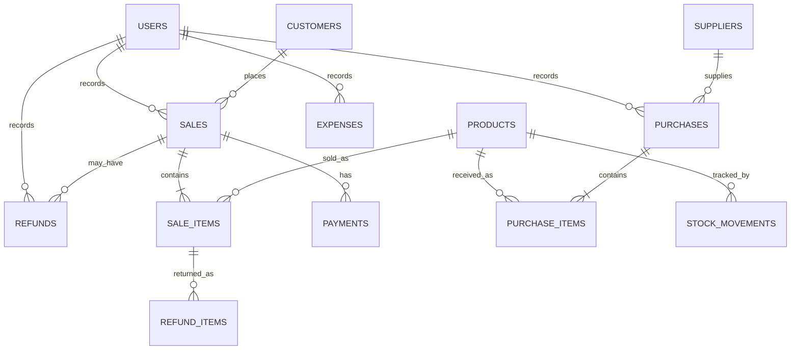

# Retail Wizard 1.0 - Architecture

## Overview

The upgraded application keeps the original desktop stack (Python + Tkinter + SQLite) so it remains a local/offline POS application, but separates presentation, business rules, database access and file generation.

## Module responsibilities

| Module | Responsibility |
|---|---|
| `app/config.py` | Application paths, defaults and runtime configuration |
| `app/db.py` | SQLite connection policy, schema creation, transactions, backup API |
| `app/security.py` | Salted PBKDF2-SHA256 password hashing and verification |
| `app/services.py` | Authentication, products, sales, payments, stock ledger, purchases, refunds, expenses, reports, audit trail |
| `app/importer.py` | Header mapping and validation for Excel/CSV product catalogues |
| `app/invoices.py` | Printable PDF invoice generation |
| `app/insights.py` | Explainable local analysis of stock, margins, expiry, refunds, sales and expenses |
| `app/ui.py` | Login/setup flow, role-aware navigation, dashboard and data-entry pages |
| `run.py` | Application entry point |

## Core data relationships

## Transaction boundaries and integrity rules

- Each checkout runs in one `BEGIN IMMEDIATE` SQLite transaction. The sale, its item snapshots, payment record, stock decrement, stock movement rows and audit event either all commit or all roll back.
- The cart is consolidated by product ID before stock validation to prevent duplicate cart lines from overselling one SKU.
- Product price, discount, tax and cost are snapshotted into sale items. Historical invoices and cost-of-goods-sold reporting therefore do not change when the catalogue is edited later.
- Refunds are item/quantity based. Refunded quantity cannot exceed the remaining sold quantity. The transaction records the refund and optionally creates a positive stock movement.
- Supplier purchase receipts and their stock increases are committed together.
- Monetary values are rounded to two decimal places using decimal arithmetic before persistence.
- SQLite foreign keys are enabled for every connection. WAL mode and a busy timeout are enabled for local access.

## Security model

- First launch requires creation of an administrator; there is no shared default password.
- Passwords use salted PBKDF2-HMAC-SHA256 hashes. Plaintext passwords are not stored.
- Roles are `admin` and `cashier`; the desktop navigation limits cashier access to the POS, product catalogue and sales history.
- Account deactivation checks prevent an administrator from disabling their own account and prevent deactivation of the last active administrator.
- Business changes write audit events.
- SQLite data and PDF invoices are local files and are **not encrypted at rest** by this edition. Use OS disk encryption and filesystem permissions.

## Payment and refund boundaries

The application records cash tender and calculates change. UPI opens a separate window with a payment URI/QR; a cashier must verify receipt using an external UPI app, enter a reference ID and manually confirm. No gateway API, webhook, bank account credential or live verification is implemented. Refunds are likewise accounting records; money must be returned through the external payment channel.

## Local insights boundary

`app/insights.py` is an explainable, offline rules engine. It analyses the current catalogue and the last 30 days of business records. It requires no API key and sends no store/customer data to an external AI provider. Its recommendations are not guaranteed forecasts and should be checked against physical stock and source records.

## Deliberate non-goals for this delivery

- Multi-store, multi-terminal network deployment or cloud synchronization.
- Customer self-service accounts/portals.
- Real payment gateway or automatic refund integration.
- Supplier email, purchase-order transmission or supplier portal.
- Encrypted database, encrypted cloud backup or regulatory accounting certification.
